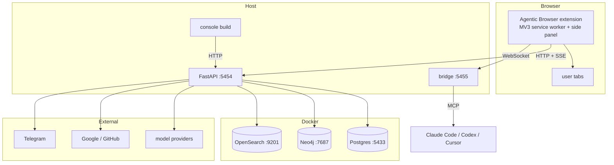
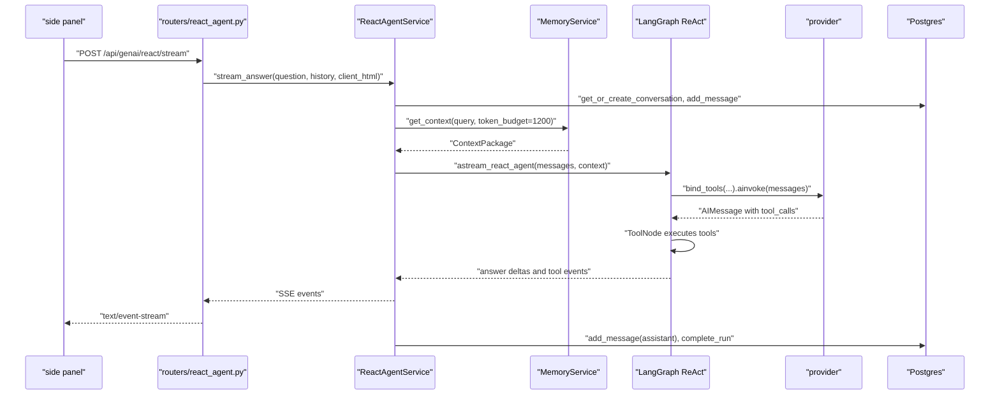
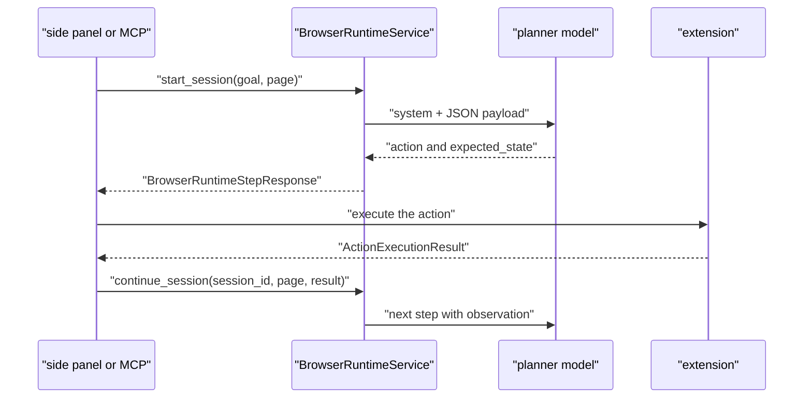
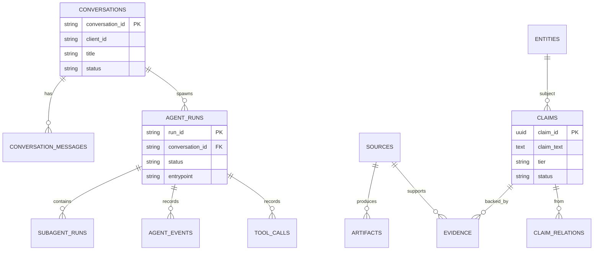
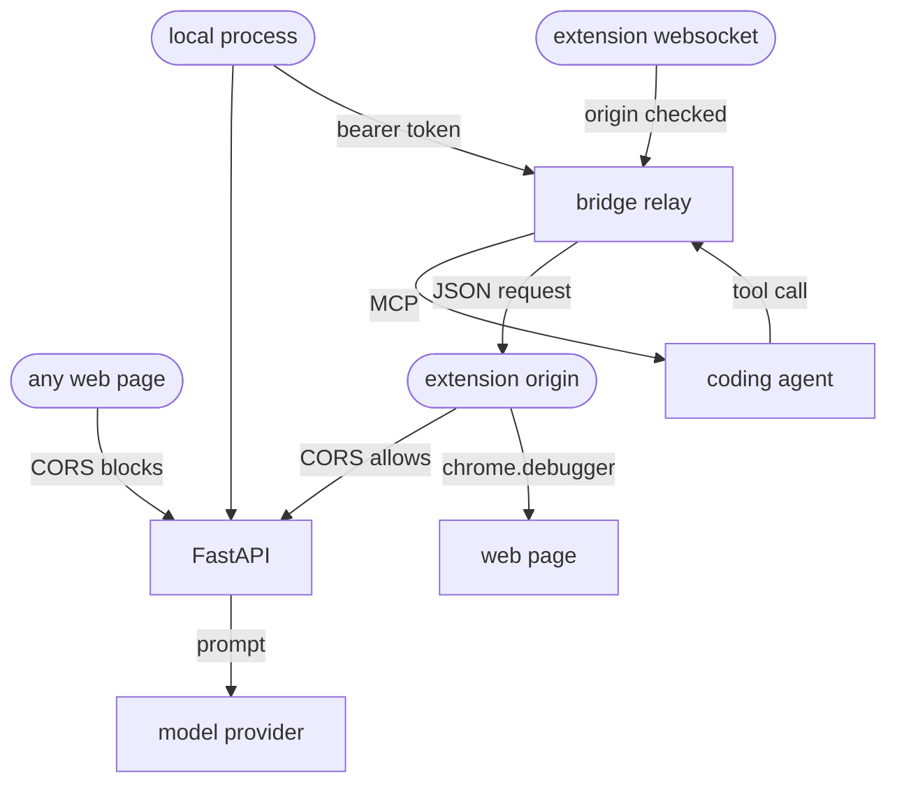
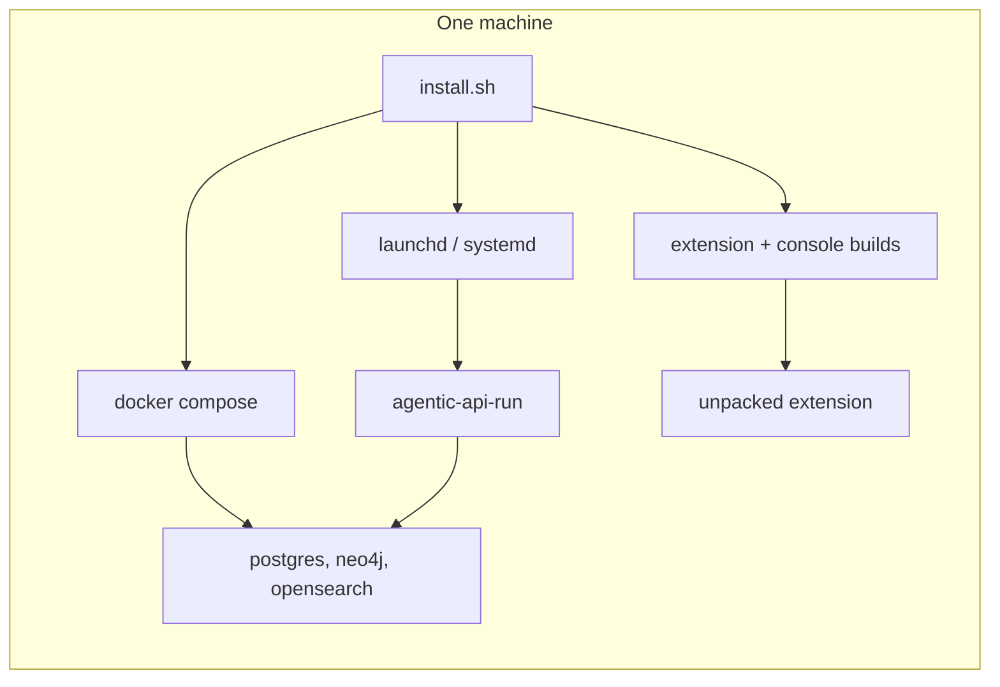
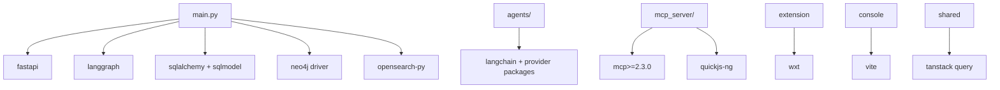

# Technical architecture overview

Agentic Browser is four processes and three stores by default. A Python backend serves HTTP and SSE on port 5454. An MCP bridge on port 5455 carries browser calls between tool clients and the extension over a WebSocket. Postgres, Neo4j and OpenSearch hold state. The extension and console are static frontends.

The architecture is deliberately plain: a request in, a plan out, an action executed by the client, an observation back. Memory, traces and subscription runtimes hang off that spine.

This page is the map of the layers and the boundaries between them. Process and port detail is on [Overall System Design](Overall%20System%20Design); backend internals are on [Backend Server Design](Backend%20Server%20Design).

Key capabilities:
- One FastAPI process for chat, memory, integrations and debug reads
- A separate bridge process, or an embedded bridge when the port is free
- Three-store memory with Postgres as the record
- LangGraph agents behind a shared tool registry
- Extension-side execution with CDP and DOM fallbacks
- Run traces persisted for every chat turn
- Per-request model selection without a restart

## Repository layout

## Layer responsibilities

Each layer owns one kind of decision and nothing above it.

| Layer | Owns | Does not own |
| --- | --- | --- |
| `clients/browser-extension` | page capture, action execution, side panel UI | planning, memory, model selection |
| `clients/debug-web` | run, memory and settings views | execution |
| `routers/` | HTTP contracts, validation, status codes | business logic |
| `services/` | orchestration, persistence, provider calls | HTTP details |
| `agents/` | LangGraph graphs and tool binding | transport |
| `memory/` | extraction, reconciliation, retrieval, maintenance | chat transport |
| `mcp_server/` | MCP protocol, bridge, code sandbox | backend imports |
| `core/` | config, DB, crypto, LLM clients, runtimes, loop guard | feature logic |

The MCP server explicitly must not import backend modules. It talks to memory over HTTP and to the browser over the bridge. That constraint is what lets it ship as a small standalone package (`agentic-browser-mcp`).

## Building blocks

- `main.py`: app construction, middleware, router mounts, `lifespan` and `run()`.
- `routers/__init__.py`: stable aliases for every router. `main.py` imports aliases, not modules.
- `services/`: `ReactAgentService`, `BrowserRuntimeService`, `ConversationService`, `RunTraceService`, `CompactionService` and the integration services.
- `agents/react_agent.py` and `agents/while_loop_harness.py`: the compiled LangGraph state machines.
- `memory/service.py`: `MemoryService`, the entry point for context reads and ingestion.
- `core/config.py`: the Pydantic settings singleton and every environment variable default.
- `core/llm.py`: provider construction, per-request overrides and the default model.

## How it fits together

A chat request crosses five boundaries. The route validates, the service builds context, the agent graph calls the model, the model calls tools, and the service persists the result.

The browser flow is shorter but crosses a different boundary. The runtime plans one action, returns it to the client, and waits for the observation.

## State ownership

Postgres is the record for conversations, runs, settings, credentials, and memory claims. OpenSearch holds the searchable copies: claim text, vectors and BM25 fields. Neo4j holds entities and claim links. The two secondary stores are written only after the Postgres transaction commits.

## Trust boundaries

The API itself has no login. Three checks compensate: CORS limits browser origins, the bridge validates extension origins and relay tokens, and the Telegram bot checks an allow list before enabling remote actions. None of these protect against another local process; the README's roadmap names that gap.

## Deployment shape

There is no cloud deployment target. The backend binds all interfaces by default, the bridge binds loopback, and the installer offers to restrict the API to loopback too. Details are on [Deployment Architecture](Deployment%20Architecture).

## Dependencies

## Performance

- The backend runs one event loop. Blocking work such as Gmail calls, GitHub clones and PDF parsing goes through `asyncio.to_thread` or a subprocess.
- Postgres uses a pool of 10 with 20 overflow. Neo4j and OpenSearch clients are module singletons.
- Chat uses SSE, not WebSockets. The extension reads the stream incrementally, so the user sees text before the run finishes.
- Memory context is budgeted at 1200 tokens for chat turns; the API default is 3000 for direct `/context` calls.
- Tool output is trimmed inside long runs when messages exceed half the model window.
- The bridge waits up to 3 seconds for a browser and adds 2 seconds to each call timeout.

## Troubleshooting

- The API answers but no trace appears: Postgres is down or the run write failed, and the service caught the exception. Check `agent_runs` and the backend log.
- The extension cannot reach the API: the panel defaults to `http://localhost:5454`; a different port or host in `baseUrl` is the usual cause.
- The bridge is up but no browser is attached: the extension is not loaded, or it points at a different bridge URL.
- Memory answers are thin: one of the secondary stores is down, so retrieval runs with fewer candidates. Check the startup warnings.
- MCP tools work but memory tools fail: the memory tools call the HTTP backend, not the bridge. Start the backend.
- A route returns 200 with an apology: the service caught the error. Read the log line before the answer.

## Appendix

### Implementation examples
- App creation: `FastAPI(title="Agentic Browser API", version="0.1.0", lifespan=lifespan)`.
- Router mount points: `/api/genai`, `/api/memory`, `/api/browser`, `/api/integrations`, `/api/debug`.
- Bridge endpoints: `GET /bridge/status`, `POST /bridge/call`, `WS /bridge/ws`, `POST /mcp`.
- Trace write: `RunTraceService.create_run`, `record_event`, `complete_run`.

### Source files
- `README.md`
- `main.py`
- `core/config.py`
- `agents/react_agent.py`
- `memory/service.py`
- `mcp_server/bridge.py`
- `models/db/app.py`
- `models/db/memory.py`
