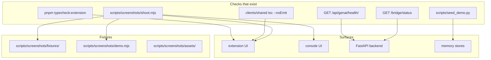
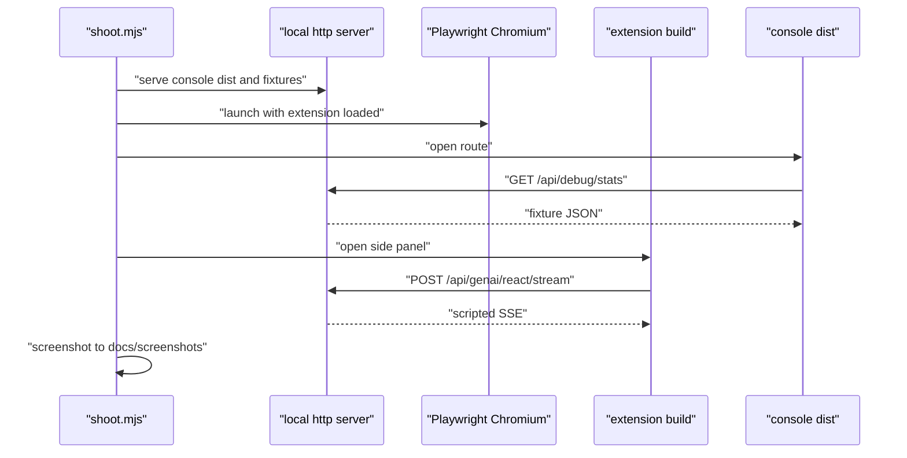
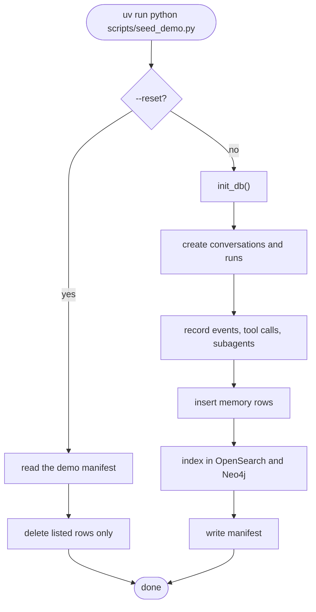
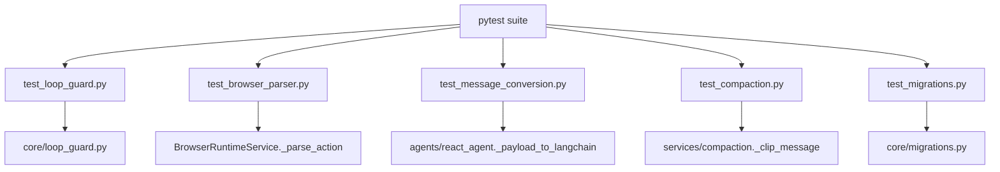
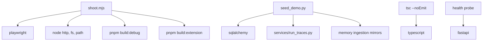

# Testing strategy

The repository has no automated test suite. There is no pytest configuration and no Vitest or Jest setup. `README.md` says it directly in the roadmap: "tests and ci. there are none. yes, really." This page documents the verification that does exist, the fixtures and scripts that make manual checks repeatable, and a concrete plan for the first tests worth adding.

Key capabilities:
- TypeScript compile checks for the extension and shared package
- A repeatable demo seed with `--reset`
- A Playwright screenshot harness with recorded fixtures
- Health and bridge probes for a running stack
- A manual QA matrix derived from real failure paths
- Named first targets for a real suite

## Repository layout

## Building blocks

- `package.json`: `typecheck:extension` delegates to the extension's `compile` script, which runs `tsc --noEmit`.
- `clients/shared/package.json`: has its own `typecheck` script, but the root does not call it.
- `scripts/seed_demo.py`: inserts a month of demo runs, events, tool calls, conversations and memory rows through the real services. `--reset` deletes only ids it recorded.
- `scripts/screenshots/shoot.mjs`: builds and serves the console, launches the extension, answers API calls from fixtures, and writes PNGs to `docs/screenshots/`.
- `scripts/screenshots/demo.mjs`: scripted SSE streams for chat screenshots.
- `scripts/screenshots/fixtures/`: recorded JSON responses named by method and sanitized URL.

## How it fits together

The only executable verification is the screenshot harness. It serves the built console, opens the extension, and intercepts every request. Writes are never forwarded. `--record` refreshes fixtures by proxying GETs to a real backend on `127.0.0.1:5454`.

The seed script exercises persistence without a browser. It calls `RunTraceService` with `_now` patched, inserts memory rows directly, mirrors them into OpenSearch and Neo4j, and records every id so `--reset` is safe.

## What is not covered

| Area | Risk | Why it matters |
| --- | --- | --- |
| ReAct graph | Tool loops, message conversion, loop guard | Every chat turn goes through it |
| Browser runtime planner | Invalid JSON, disallowed actions, blockers | A bad plan clicks the wrong thing |
| Bridge handlers | Ref resolution, frame routing, dialogs | MCP clients depend on exact selectors |
| Memory reconciliation | Duplicate, update, contradiction | A wrong supersede loses a fact |
| Compaction | Summary boundaries, token budget | Long chats silently lose context |
| OAuth refresh | Expiry, revocation, rotation | Tools fail with no clear cause |
| Migrations | Ordering, idempotence | Startup fails on an existing database |
| Extension build | Manifest permissions | The extension will not load |

The README names the first three as intended starting points: the memory reconciler, the browser-runtime parser and the bridge handlers.

## Manual QA matrix

| Check | Steps | Pass condition |
| --- | --- | --- |
| Chat stream | Ask "summarise this page" | Answer streams, work log shows tool rows, `final` arrives |
| Browser action | Ask "open example.com and read the title" | One action planned, executed, observation returns |
| Loop guard | Ask for a task that repeats a failing click | Warning, then a stop with findings |
| Memory write | Say "remember I prefer dark mode", reload, ask again | Recall includes the preference |
| Memory forget | Forget the claim in the console | Claim gone, chat turn redacted |
| Compaction | Lower the budget, send a long chat | Summary event, recent messages verbatim |
| Attachment | Upload a PNG, ask about it | Image reaches the model, or a refusal |
| MCP | `agentic-mcp status`, then `browser_snapshot` | Outline with `[ref=eN]` |
| Code mode | Run a two-step `browser_execute` | Returns only the value, `while(true)` dies |
| Restart | Restart the backend | `/bridge/status` shows the extension reattached |

## A first test suite

Cases worth writing first:

- `LoopGuard.record` warns on the second identical `(call, outcome)` pair, then stops after `grace`.
- `LoopGuard._cycle` detects A, B, A, B and not a three-item unique sequence.
- `fingerprint(mask_digits=True)` maps `12` and `99` to the same outcome hash.
- `_parse_action` rejects types outside `allowed_actions`.
- `_extract_json` reads the first object and ignores trailing prose.
- `_payload_to_langchain` keeps non-text blocks for a user message.
- `_normalise_content` drops thinking-only blocks instead of dumping JSON.
- `estimate_tokens` and `_clip_message` preserve head and tail.
- Migration discovery returns `0001`, `0002`, `0003` in order.
- `mcp_server/settings.enabled_tools` removes the right tools per mode.

For the frontend, a Vitest setup over `clients/shared` would cover `withBase`, `readError`, `qs` and the SSE line parser in `clients/debug-web/src/lib/api.ts`.

## Dependencies

## Performance

- The screenshot run builds both frontends first; a cold run is dominated by Vite and WXT.
- Playwright runs one Chromium profile; the harness is serial.
- `seed_demo.py` writes a month of activity and is not batched.
- Type checking is incremental only within one `tsc` invocation.
- Fixtures make screenshot runs deterministic and offline; `--record` is the only mode that touches a live backend.

## Troubleshooting

- `pnpm typecheck:extension` fails before any source error: run `pnpm install`; WXT generates `.wxt/types` in `postinstall`.
- Screenshots show empty charts: a fixture is missing. Re-run with `--record` against a seeded backend.
- Seed reset deletes nothing: the manifest under `~/.agentic-browser/` was removed or the run was interrupted.
- Playwright cannot launch Chromium: run `pnpm exec playwright install chromium`.
- Tests cannot import backend modules: run pytest through `uv run pytest`.
- A manual check passes in the console but fails in the extension: the extension uses `chrome-extension://` and depends on the CORS regex.

## Appendix

### Implementation examples
- Type check: `pnpm typecheck:extension`.
- Seed: `uv run python scripts/seed_demo.py`, reset with `--reset`.
- Screenshots: `pnpm screenshots`, refresh with `--record`.
- Health: `curl http://127.0.0.1:5454/api/genai/health/`.
- Bridge: `curl http://127.0.0.1:5455/bridge/status`.

### Source files
- `README.md`
- `scripts/seed_demo.py`
- `scripts/screenshots/shoot.mjs`
- `scripts/screenshots/demo.mjs`
- `package.json`
- `clients/browser-extension/package.json`
- `clients/debug-web/package.json`
- `clients/shared/package.json`
- `core/loop_guard.py`
- `services/browser_runtime_service.py`
- `services/compaction.py`
