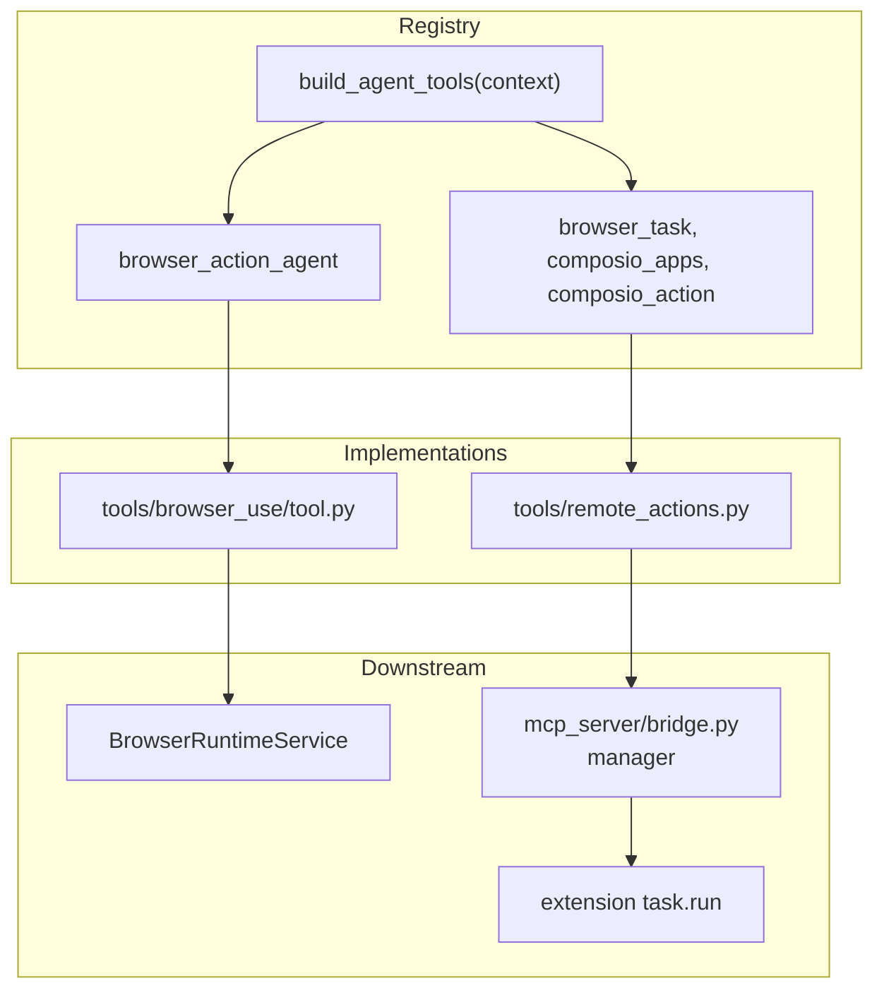
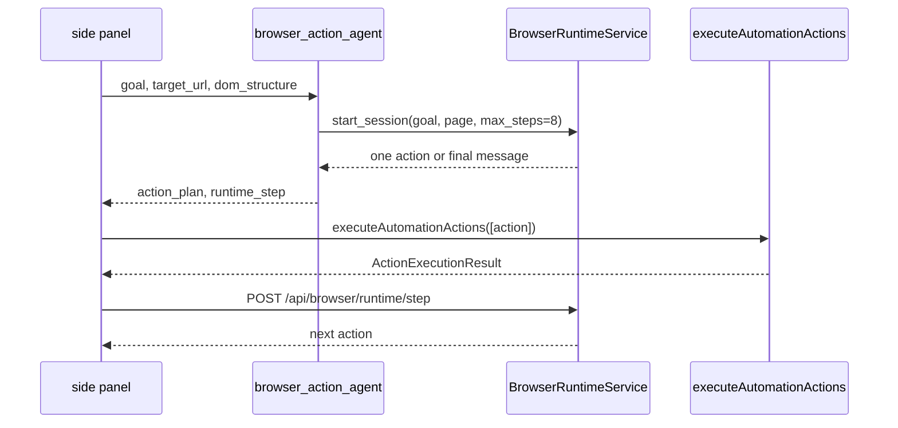
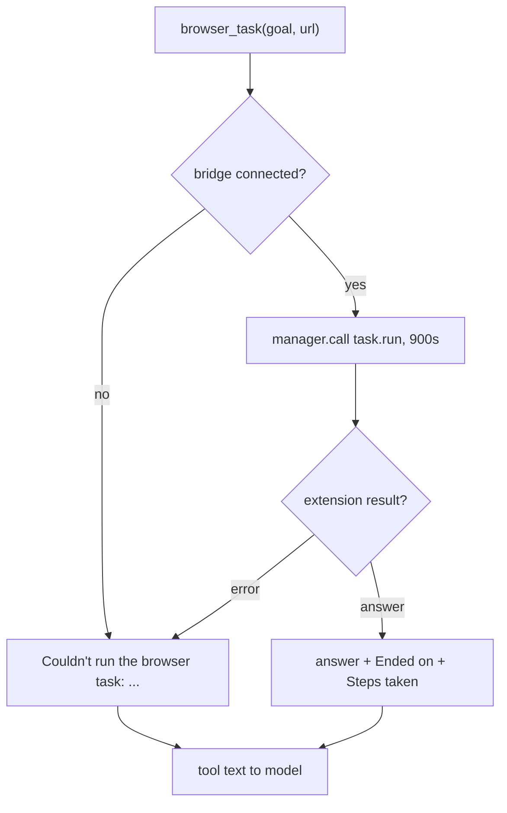
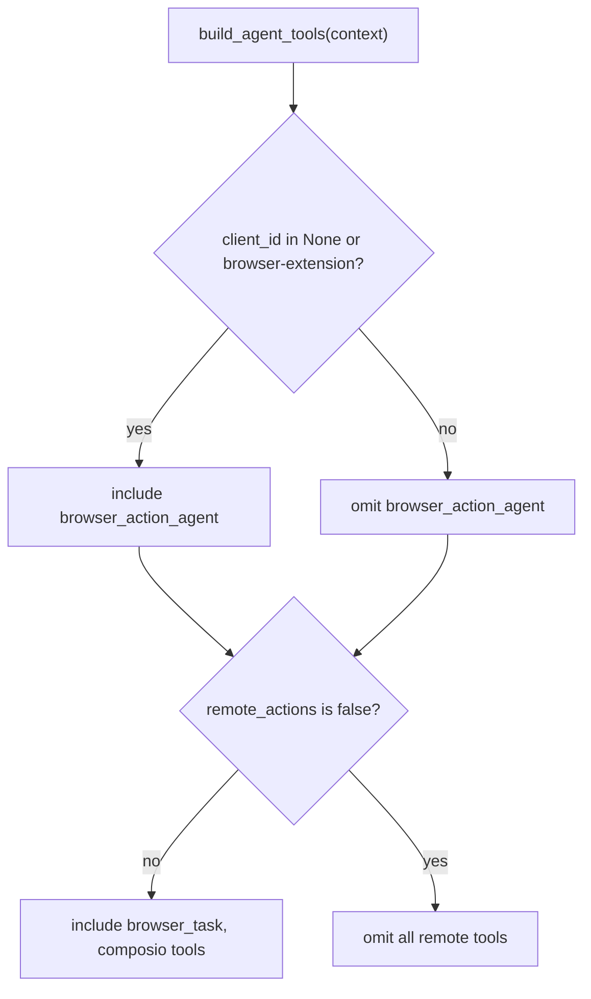
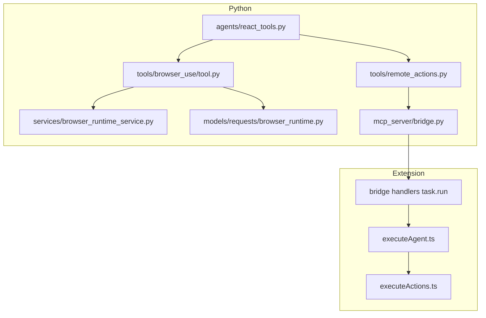

# Browser automation tools

Two tools in `agents/react_tools.py` expose browser work to the model. `browser_action_agent` asks the runtime planner for the next action and hands it back to a client that can execute it. `browser_task` sends a complete goal to the user's browser through the local bridge and waits for a finished run.

The split matters. A side panel has an executor, so it wants one action at a time and runs it itself. Telegram, the console, and MCP clients do not, so they get the whole task. The registry decides which tool to include from the request context.

Key capabilities:
- `BrowserActionInput` with a goal, an optional target URL, DOM structure, and constraints.
- One planned action per call, returned as `action_plan.actions`.
- `BrowserTaskInput` with a goal and an optional starting URL for a full remote run.
- Automatic exclusion of `browser_action_agent` outside the side panel.
- Automatic exclusion of all three remote tools when `remote_actions` is false.
- Plain-text remote results with an ending URL and a short trail.

## Repository layout

The tools are thin wrappers. `tools/browser_use/tool.py` owns `BrowserActionInput` and calls `BrowserRuntimeService.start_session`. `tools/remote_actions.py` owns `BrowserTaskInput` and calls the bridge manager. `agents/react_tools.py` builds the wrappers and decides which ones go into the request's tool list.

## The browser action tool

`browser_action_agent` is the side-panel tool. Its input model is `BrowserActionInput`:

- `goal`: the user's goal or instruction for the browser.
- `target_url`: the URL to navigate to, if applicable. Defaults to an empty string.
- `dom_structure`: optional DOM structure of the current page. Defaults to an empty dict.
- `constraints`: optional constraints for the action. Defaults to an empty dict.

`_browser_action_tool` converts the DOM payload with `build_page_snapshot_from_dom`, then calls `BrowserRuntimeService.start_session` with `max_steps=8` and `context` containing `target_url`, `constraints`, and `source="browser_action_agent"`. It does not execute anything. The response tells the caller whether an action is ready:

- `ok`: false only when the step status is `failed`.
- `message` and `reason`: the planner's explanation.
- `runtime_step`: the full `BrowserRuntimeStepResponse`.
- `requires_dom_refresh`: true when an action came back.
- `action_plan`: `{"actions": [action]}` when an action came back.

The side panel then executes that one action with `executeAutomationActions`, captures a new page, and calls `POST /api/browser/runtime/step`. The planner and the step contract are documented in [Dynamic Script Generation](../Browser%20Automation/Dynamic%20Script%20Generation). Execution is documented in [DOM Manipulation and Element Targeting](../Browser%20Automation/DOM%20Manipulation%20and%20Element%20Targeting).

## The remote browser tool

`browser_task` is the full-run tool. Its input model is `BrowserTaskInput`:

- `goal`: what the browser should accomplish.
- `url`: optional starting page, validated by the extension as `http://` or `https://`.

The tool calls `manager.call("task.run", {"goal": goal, "url": url}, timeout=TASK_TIMEOUT)` where `TASK_TIMEOUT = 15 * 60`. The extension opens the URL in a new tab or uses the active tab, runs the planner loop, and returns `answer`, `steps`, `trail`, `url`, and `title`.

The formatted tool text starts with the answer, then `Ended on: <title> <url>` when a URL came back, then `Steps taken (<steps>):` with one bullet per trail entry. A bridge failure returns `Couldn't run the browser task: ...` as ordinary tool text. The calling model can retry, narrow the goal, or report the failure without the turn crashing.

The transport, lock, and stop behaviour are covered in [Remote Browser Tasks](../Browser%20Automation/Remote%20Browser%20Tasks).

## Conditional inclusion

`build_agent_tools` computes `in_side_panel = ctx.get("client_id") in (None, "browser-extension")`. Only a side panel gets `browser_action_agent`, because only a side panel has code that can execute the returned action. Every client gets `browser_task` unless `ctx.get("remote_actions") is False`, which is how Telegram keeps browser work off for chats outside its allow list.

This is why the same agent can behave correctly in three places without prompt branching. A missing tool is clearer to the model than a tool that fails on every call.

## Dependencies

Both tools depend on modules that import service code at module load. `tools/browser_use/tool.py` imports `BrowserRuntimeService` and the request models. `tools/remote_actions.py` imports the bridge manager lazily inside `_browser_task`, which avoids a circular import with `mcp_server`. `agents/react_tools.py` imports the first at module load and the remote tools inside `build_agent_tools`.

`langchain-core` supplies `StructuredTool` and `pydantic` supplies the input models. The browser tool also uses `BrowserRuntimeStartRequest`, so a change to the runtime request contract reaches the tool schema through the service call.

## Performance

`browser_action_agent` costs one chat completion per call and no database write unless `persist` is set, which the tool leaves off. Its page payload is bounded by `build_page_snapshot_from_dom` to 80 interactive entries and 5000 characters of text. `browser_task` costs one round trip plus the whole remote loop, capped at 900 seconds by the tool and 1800 seconds by the bridge. The extension returns at most 25 trail entries.

## Troubleshooting

- `browser_action_agent` is missing: the request had a `client_id` other than `None` or `browser-extension`. Use `browser_task` for that client, or send the side-panel id.
- `browser_task` is missing: `remote_actions` was explicitly `false`. This is expected for Telegram chats outside the allow list.
- The tool returns no action: the planner finished, blocked on a captcha or login, or dropped an invalid action type. Read `runtime_step.reason`.
- The side panel never executes anything: `browser_action_agent` only plans. The caller must run `executeAutomationActions` and post the result to `/step`.
- `Couldn't run the browser task: ...`: the bridge had no connected extension or the socket dropped. Check the extension popup and the bridge status.
- The remote task times out at 900 seconds: the run is still alive in the extension. Send `task.stop` before retrying.
- The goal needs a login the browser already has: use `browser_task` so the run happens in the user's own profile. A server-side fetch cannot see those cookies.

## Appendix

### Implementation examples

- `_browser_action_tool(goal, target_url, dom_structure, constraints, _client_markdown="")`: builds the page, starts a session, shapes the result.
- `BrowserActionInput`: the schema the model sees for one action.
- `_browser_task(goal, url=None)`: bridge call with a 900 second timeout.
- `build_agent_tools(context)`: decides which browser tool the request receives.

### Source files

- `agents/react_tools.py`
- `tools/browser_use/tool.py`
- `tools/remote_actions.py`
- `models/requests/browser_runtime.py`
- `services/browser_runtime_service.py`
