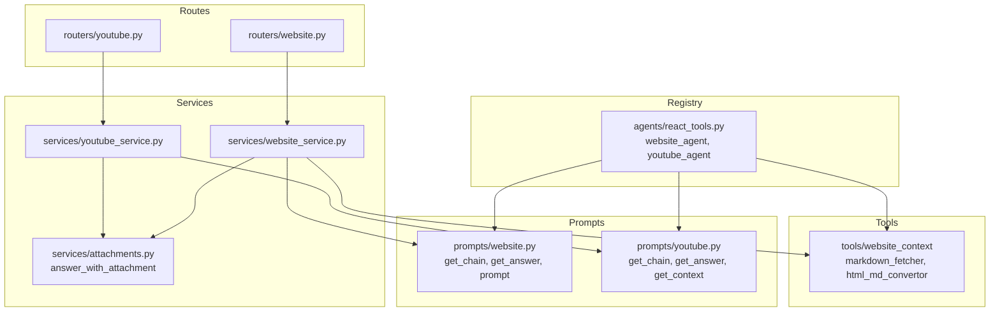
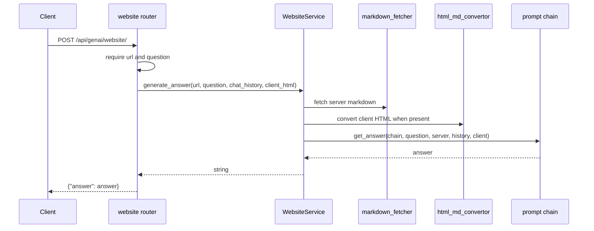
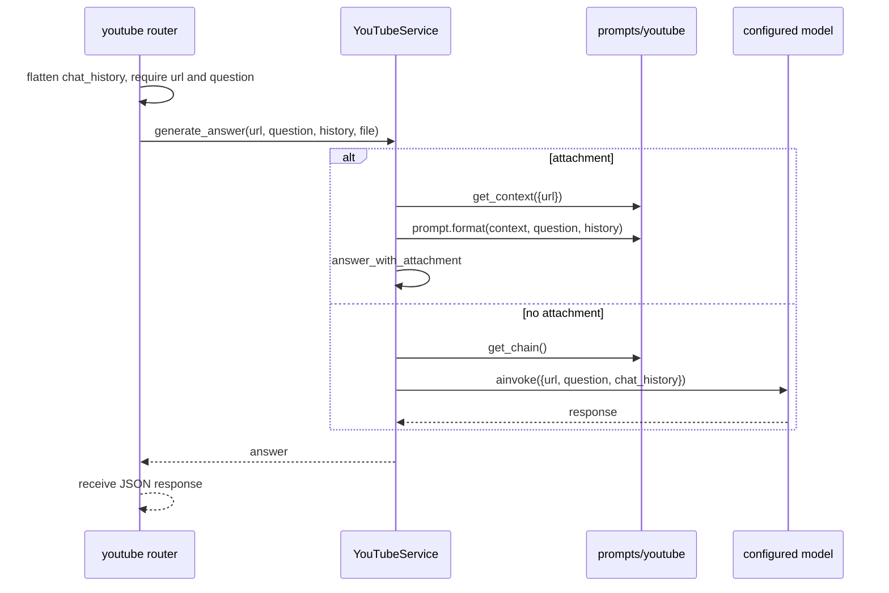
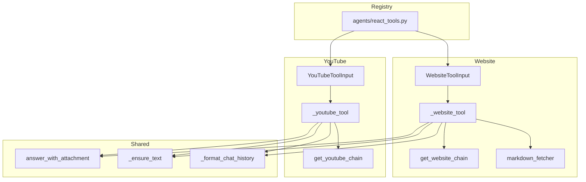

# Content processing and extraction tools

The website and YouTube tools answer a question about a page or a video in one call. `website_agent` and `youtube_agent` in `agents/react_tools.py` wrap the same prompts and services the HTTP routes use. There is no agent loop and no conversation state: the tool fetches context, renders a prompt, calls the configured model, and returns text.

Two routes mirror the tools: `POST /api/genai/website/` and `POST /api/genai/youtube/`. Both return `{"answer": str}`. A serious failure usually comes back as an apology string with HTTP 200, because the service catches its own exceptions.

Key capabilities:
- Website Q&A with a server-side markdown fetch and an optional client HTML conversion.
- YouTube Q&A over a fetched transcript.
- Chat history formatting shared by both tools.
- Attachment support through `answer_with_attachment`.
- Bounded web search summaries next to the two content tools.
- Fresh chains per request so the selected model applies.

## Repository layout

`prompts/website.py` and `prompts/youtube.py` hold the chains and prompt templates. `tools/website_context` holds `markdown_fetcher` and `html_md_convertor`. The services own the fetch and prompt assembly; the routers validate request fields.

## Building blocks

- `WebsiteToolInput`: `url` as `HttpUrl`, `question`, and optional `chat_history` as a list of `{role, content}` maps.
- `YouTubeToolInput`: the same shape for a video URL.
- `WebsiteRequest`: `url`, `question`, `chat_history`, `client_html`, `attached_file_path`.
- `AskRequest`: `url`, `question`, `chat_history`, `attached_file_path`.
- `get_website_chain()` and `get_youtube_chain()`: return a fresh chain per call so a model override applies.
- `_format_chat_history(history)`: flattens dict entries into `role: content` lines and stringifies anything else.
- `_ensure_text(response)`: returns a string, reads `.content`, or JSON-dumps the value.

## Website question answering

`_website_tool` calls `markdown_fetcher(str(url))` in a thread, formats history, builds the chain, and calls `get_website_answer` in a thread. The route path is similar, but adds `client_html`. `WebsiteService.generate_answer` fetches server markdown, converts `client_html` with `html_md_convertor` when present, and passes both contexts to the chain.

The dual context matters on logged-in or client-rendered pages. The server fetch sees what an anonymous request sees. The client HTML comes from the extension and includes the DOM the user is actually looking at. The prompt receives `server_context` and `client_context`, and the latter is marked unavailable when no HTML was sent.

The route returns 400 `url and question are required` when either field is empty. Other exceptions become 500 with `Internal server error` and the exception text. If `attached_file_path` is set, the service renders the same prompt and calls `answer_with_attachment(rendered, path)` so the model sees the file as a message part instead of as prompt text.

## YouTube question answering

`_youtube_tool` formats history, builds a fresh chain, and calls `get_youtube_answer(chain, question, str(url), history)` in a thread. The service path is asynchronous and awaits `get_chain().ainvoke({url, question, chat_history})`, so the event loop is not blocked during the model call.

The chain resolves the video URL to a transcript through `get_context` and then answers with the transcript, question, and history in the prompt. As with the website path, an attachment switches to `answer_with_attachment` after rendering the prompt. That branch fetches the transcript in a thread with `asyncio.to_thread(get_context, {"url": url})` before rendering.

The route flattens `chat_history` itself before calling the service, and requires `url` and `question` with the same 400 message as the website route. The service catches model and transcript errors and returns `I apologize, but I encountered an error processing your question about the video. Please try again.`

## Web search next to the content tools

`websearch_agent` is not a content extractor in the same sense, but it shares the research slot in the registry. It calls `web_search_pipeline(query, None, max_results)` in a thread, bounds results to 1 through 10, and formats each hit as a `URL:` line and a `Summary:` line capped at 320 characters. An empty result returns `No web results were found.`

This is the fallback when a page cannot be fetched or a question is broader than one document. It does not share code with `markdown_fetcher`; it is a separate pipeline with its own provider.

## Dependencies

Both tools import prompt modules and tools at module load. The website path depends on the markdown fetcher and the HTML converter. The YouTube path depends on transcript retrieval inside the prompt module. Attachments depend on `services/attachments.py` and the active model's file support.

`pydantic[email]>=2.9.0` supplies `HttpUrl`, so a bare hostname fails validation before any network call. `langchain>=0.3.27` supplies the prompt chain types. `yt-dlp>=2026.3.3` is used by the YouTube context path.

## Performance

- `markdown_fetcher` runs in a thread in the agent tool and synchronously inside the service, so a slow page delays the request but not the event loop in the tool path.
- The YouTube chain is built per request. This costs a small object allocation and guarantees the model picker applies.
- Transcript retrieval and model calls are the slow parts; neither has a cache in these modules.
- Web search summaries are capped at 10 results and 320 characters each, which bounds prompt size.
- Attachment answers skip the chain and send the file as a message part, so the prompt itself stays the same size.

## Troubleshooting

- The answer ignores the live DOM: `client_html` must be sent. The server fetch may see a logged-out or pre-render version of the page.
- A 200 response contains an apology: the service caught a fetch or model error and logged it. Check the server log for the real exception.
- Website route returns 500 for a blank field: the service was called past the route guard, or the fetcher raised. The route itself returns 400 for empty `url` or `question`.
- YouTube answers are empty or generic: the transcript fetch failed, or the video has no accessible transcript. Check `get_context` and the model log.
- `HttpUrl` rejects the input: pass `https://...`, not a bare hostname.
- Attachment answers fail: the selected model may not accept file parts, or the path is outside the uploads root.
- Web search returns an empty string of results: the provider returned nothing or the query was too narrow. The tool reports `No web results were found.`

## Appendix

### Implementation examples

- `_website_tool(url, question, chat_history)`: fetch, format, chain, return text.
- `_youtube_tool(url, question, chat_history)`: chain per call, thread offload.
- `_websearch_tool(query, max_results=5)`: bound results and trim summaries.
- `WebsiteService.generate_answer(...)`: server plus client context.
- `YouTubeService.generate_answer(...)`: attachment branch and awaited chain.

### Source files

- `agents/react_tools.py`
- `services/website_service.py`
- `services/youtube_service.py`
- `routers/website.py`
- `routers/youtube.py`
- `prompts/website.py`
- `prompts/youtube.py`
