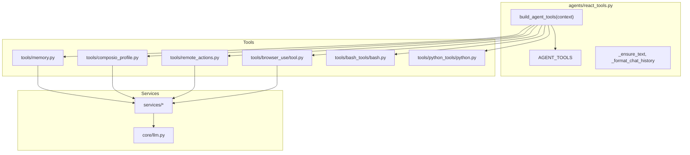
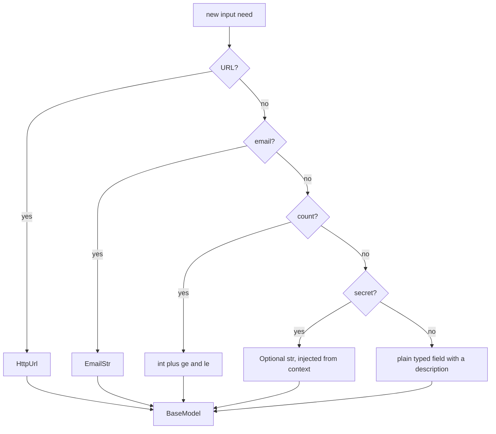
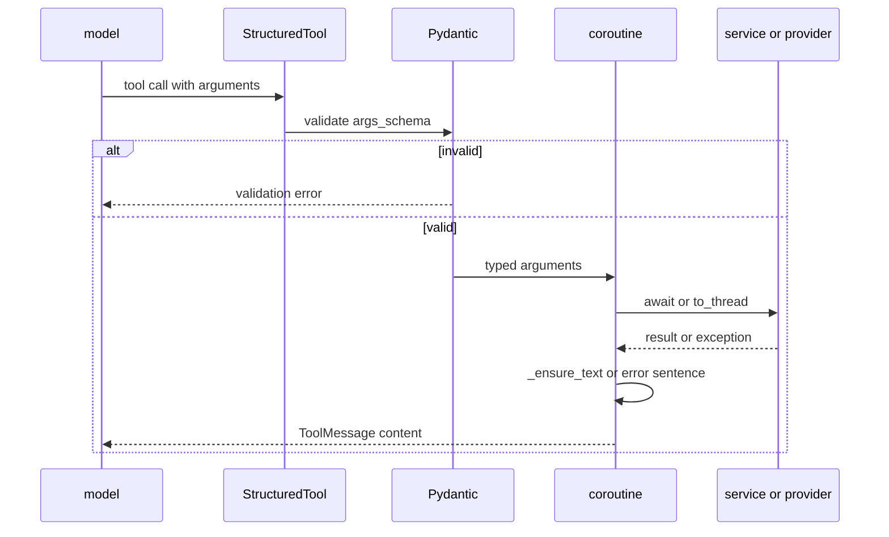
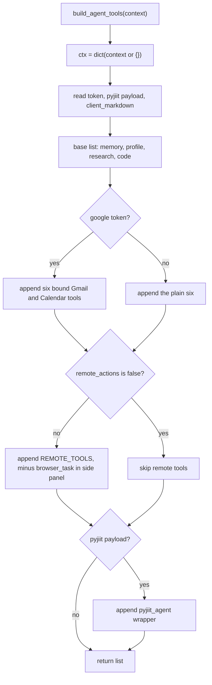
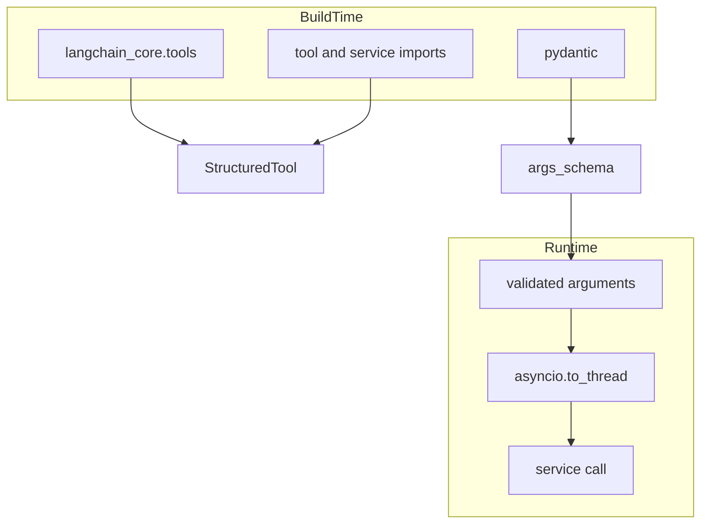

# Custom tool development guide

A tool in this project is a LangChain `StructuredTool` with a Pydantic input model and an async coroutine. The registry in `agents/react_tools.py` decides which tools exist for a request, and `build_agent_tools(context)` injects credentials so the model never has to pass a token by hand.

This guide follows the path a new tool takes: input model, coroutine, registration, context wiring, and the checks that catch bad input before a service call. The design rationale behind the registry is in [Tool architecture and design](Tool%20Architecture%20and%20Design).

Key capabilities:
- Typed inputs with `Field` bounds and descriptions the model can read.
- Async coroutines that keep blocking work off the event loop.
- Context injection for tokens, session payloads, and client-specific variants.
- Stable tool names shared by the ReAct agent and supervisor partitions.
- Plain-text errors instead of exceptions that break a turn.
- Conditional registration so unavailable integrations stay out of the tool list.

## Repository layout

Tool code lives under `tools/<domain>/`. The registry imports it, wraps it, and adds it to the list for one request. Services under `services/` hold shared logic, and prompts under `prompts/` compose model input.

## Building blocks

- `StructuredTool`: name, description, coroutine, and `args_schema`. This is the only interface the model sees.
- Pydantic input classes: `GitHubToolInput`, `WebSearchToolInput`, `WebsiteToolInput`, `YouTubeToolInput`, `GmailToolInput`, `GmailSendEmailInput`, `GmailListUnreadInput`, `GmailMarkReadInput`, `CalendarToolInput`, `CalendarCreateEventInput`, `PyjiitAttendanceInput`, and `BrowserActionInput`.
- `_ensure_text(value)`: returns strings as-is, reads `.content`, and JSON-dumps anything else.
- `_format_chat_history(history)`: flattens `{role, content}` maps into prompt lines.
- `build_agent_tools(context)`: reads the request context and returns the ordered tool list.
- `AGENT_TOOLS = build_agent_tools()`: the no-context default used by `GraphBuilder`.

## Define the input model

Start with a `BaseModel`. Use `Field` descriptions as documentation for the model, and constraints for values that would otherwise reach a service unchecked. Existing bounds are deliberate: `WebSearchToolInput.max_results` is 1 to 10, `GmailToolInput.max_results` is 1 to 25, `GmailListUnreadInput.max_results` is 1 to 50, `CalendarToolInput.max_results` is 1 to 25, `RecallMemoryInput.top_k` is 1 to 20, and `WriteMemoryInput.importance` and `confidence` are 0 to 1.

URLs use `HttpUrl`, which requires a scheme. Emails use `EmailStr`, which requires the `pydantic[email]` extra already pinned in `pyproject.toml`. Optional fields should have a default that makes the common call short. A token field can stay optional and be filled from context.

## Implement the coroutine

The coroutine does three things: validate what Pydantic cannot, call the service or provider, and return text or JSON. `_ensure_text` normalises LangChain response objects. Blocking HTTP clients and provider SDKs go through `asyncio.to_thread`, which is the pattern used by `_websearch_tool`, `_website_tool`, `_youtube_tool`, and the Gmail and Calendar wrappers.

Errors should come back as sentences the model can act on. `_gmail_tool` returns a message when no token and no Composio account are available. `_browser_task` catches `BridgeError` and returns `Couldn't run the browser task: ...`. Memory writes return JSON with the new claim id, tier, segment, and class. The turn continues in every case.

## Register the tool

Module-level tools are created at import and reused: `github_agent`, `websearch_agent`, `website_agent`, `youtube_agent`, `gmail_agent`, `gmail_send_email`, `gmail_list_unread`, `gmail_mark_read`, `calendar_agent`, `calendar_create_event`, and `pyjiit_agent`. Add a new static tool next to them when it needs no request data.

Request-built tools belong inside `build_agent_tools`. There are three patterns in the current code:

- Append an imported collection, as with `MEMORY_TOOLS` and `COMPOSIO_PROFILE_TOOLS`.
- Build a wrapper that closes over context, as with the Gmail, Calendar, PyJIIT, and browser wrappers.
- Append conditionally, as with `REMOTE_TOOLS` and `browser_action_agent`.

Keep the tool name stable once it ships. The supervisor partitions tools by name, and prompts refer to names directly.

## Context and credentials

The context dict is the only place request-scoped credentials belong. The builder reads `google_access_token` or `google_acces_token`, `pyjiit_login_response` or `pyjiit_login_responce`, `client_markdown`, `client_id`, and `remote_actions`. The two spellings are historical compatibility, not a typo to clean up without checking callers.

When a Google token is present, the Gmail and Calendar wrappers pass it as `_default_token`, and the tool schema still exposes `access_token` as a legacy direct option. Follow that pattern for a new provider: close over the request credential, keep the schema field optional, and never log the value.

## Testing a new tool

Test the schema, the coroutine, and the assembled list separately. Pydantic gives cheap tests for missing fields and bad URLs. Mock the service for the coroutine test and assert the returned text. Build the list with and without context to prove the conditional branches.

A useful checklist:
- The input model rejects a bare hostname and accepts `https://`.
- The coroutine returns a sentence, not an exception, when the provider fails.
- The tool appears in `build_agent_tools()` without context.
- The tool disappears when its credential is absent and the contract says it should.
- The description names the action, not the implementation.
- The result is bounded in size.

## Dependencies

The registry imports service and tool modules at module load, so a broken optional import can fail the whole tool list. Keep heavy provider SDK imports inside the coroutine when the tool is conditional. `langchain-core` supplies `StructuredTool`; `pydantic` supplies the schemas.

## Performance

Bounds belong in the schema, not in prompt advice. A search tool that accepts 1 to 10 results cannot return 50 by accident. Offload every blocking call, especially `requests` clients with 8 to 10 second timeouts, so one slow provider does not stall the event loop. Trim result text close to the source, as `_websearch_tool` does at 320 characters per summary and `_composio_action` does at 12000 characters.

## Troubleshooting

- The model never calls the tool: the description is vague or the name collides. Describe the action and the object, not the module.
- `HttpUrl` rejects a URL: the model sent a bare hostname. Make the field description say `https://...`.
- The tool takes the wrong credential path: context injection did not run, so the wrapper fell back to the plain module-level tool. Check the context key spelling.
- Importing `agents.react_tools` fails: a module-level import of an optional integration broke. Move the import inside the coroutine or guard it.
- The tool appears in the wrong client: check `client_id` and `remote_actions` in `build_agent_tools`.
- Errors crash the turn: the coroutine raised instead of returning text. Catch provider exceptions and return a sentence.
- Output floods the context: add a cap in the coroutine and mention the cap in the field description.

## Appendix

### Implementation examples

- `build_agent_tools(context=None)`: returns the ordered tool list for one request.
- `_websearch_tool(query, max_results=5)`: bounds and formats search output.
- `_website_tool(url, question, chat_history)`: fetch and chain in threads.
- `_gmail_tool(...)`: Composio first, direct API when a token exists.
- `_browser_task(goal, url=None)`: bridge call with a 900 second timeout.
- `_write_memory(...)`: coerces labels, stores a claim, returns JSON.

### Source files

- `agents/react_tools.py`
- `tools/memory.py`
- `tools/remote_actions.py`
- `tools/composio_profile.py`
- `tools/browser_use/tool.py`
