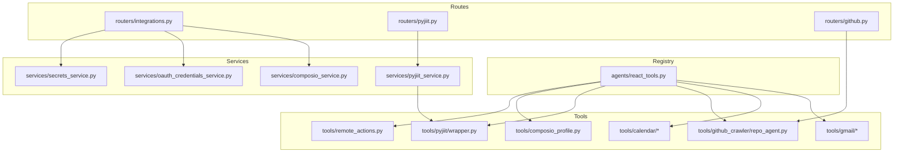
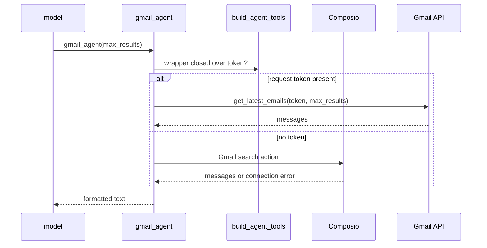
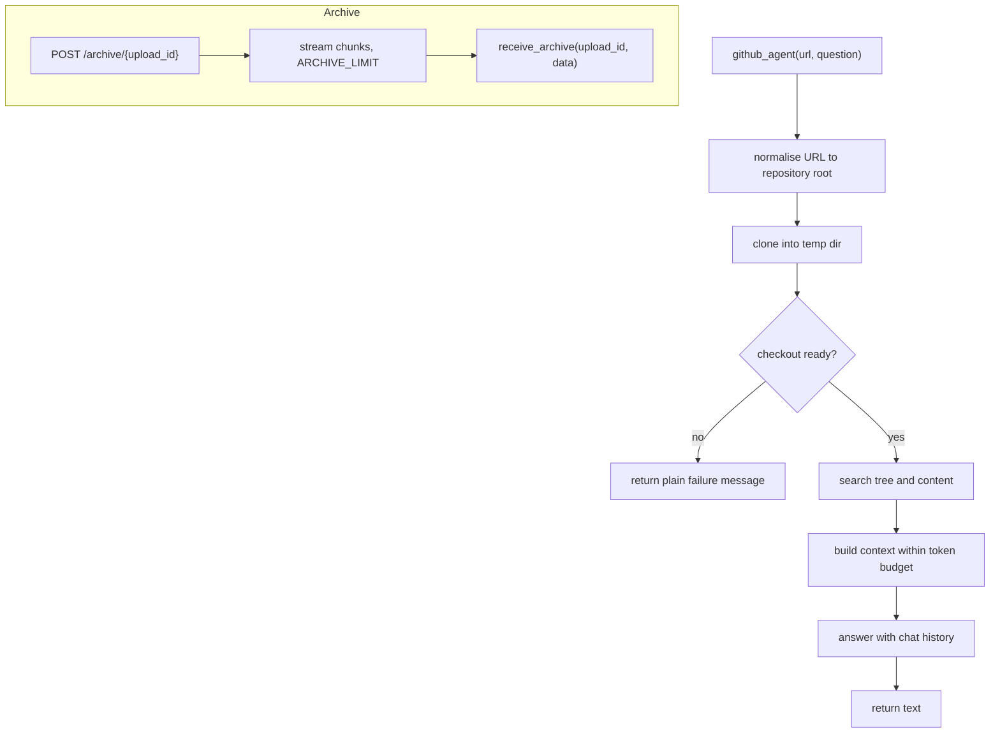
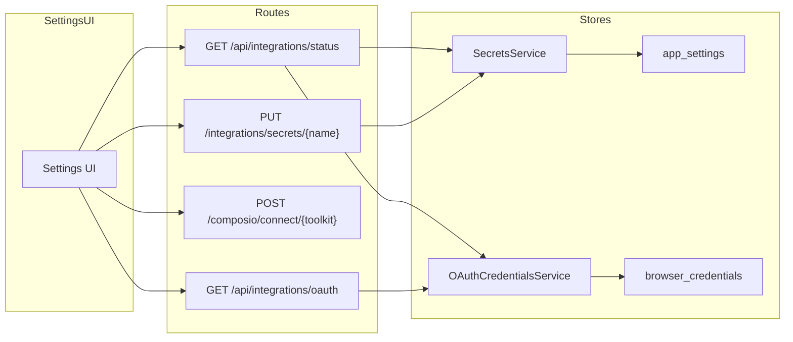
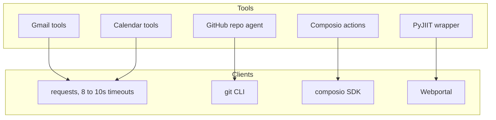

# External service integration tools

The registry exposes five external services to the model: Gmail, Google Calendar, GitHub repositories, the PyJIIT campus portal, and Composio toolkits. Each is a `StructuredTool` with a typed schema. Credentials arrive from request context or from a connected Composio account, never from the model's prompt.

The routes under `/api/integrations` report what is configured and start OAuth flows. The tools read the results through the same services. That keeps a settings change and an agent call on one credential path.

Key capabilities:
- Four Gmail operations and two Calendar operations with a direct token or Composio fallback.
- A GitHub repository agent with a read-only checkout and a private archive upload path.
- A PyJIIT attendance tool with a session payload and semester selection.
- Composio app discovery and exact action execution.
- Per-request token injection so the model does not handle secrets.
- Integration status that reports configured flags, not values.

## Repository layout

Tool modules live under `tools/`. Services wrap the provider calls and auth. `routers/integrations.py` is the control surface for status, OAuth, Composio connections, and native tool listings.

## Gmail and Calendar

The four Gmail tools are `gmail_agent`, `gmail_send_email`, `gmail_list_unread`, and `gmail_mark_read`. The two Calendar tools are `calendar_agent` and `calendar_create_event`. Their schemas are `GmailToolInput`, `GmailSendEmailInput`, `GmailListUnreadInput`, `GmailMarkReadInput`, `CalendarToolInput`, and `CalendarCreateEventInput`.

Each schema exposes an optional `access_token` described as a legacy direct Google OAuth token. When `build_agent_tools` sees a request-level Google token, it builds a wrapper that closes over the token and passes it as `_default_token`. The model can still override it, but normally does not need to.

Without a request token, the Gmail tools fall back to Composio. The direct path calls `get_latest_emails`, `list_unread`, `mark_read`, or `send_email`, all of which use the Gmail REST API with an `Authorization` header and 8 second request timeouts. Calendar uses `get_calendar_events` and `create_calendar_event` with 8 and 10 second timeouts. The Calendar list filters by time and orders by start time; creation sets the timezone to UTC.

Input bounds apply before either path runs. Gmail retrieval is capped at 25 messages, unread listing at 50, Calendar at 25 events. `GmailSendEmailInput` requires `to` as `EmailStr` and non-empty `subject` and `body`.

## GitHub repository agent

`github_agent` takes `GitHubToolInput`: a public repository URL as `HttpUrl`, a question, and optional chat history. It calls `run_github_repo_agent(url, question, chat_history)` in `tools/github_crawler/repo_agent.py`. The agent clones into a temporary directory, checks out the default branch, and answers from a read-only checkout.

The HTTP route `POST /api/genai/github/` wraps the same function. It requires `question` and `url`, but its broad exception handler turns its own 400 into a 500, so check the detail text. A large private archive can be uploaded through `POST /api/genai/github/archive/{upload_id}`. That handler streams the body, enforces `ARCHIVE_LIMIT`, and returns 413 `Archive over 300 MB.` when exceeded. `receive_archive(upload_id, data)` returns false when no download is waiting, which becomes 404.

## PyJIIT attendance

`pyjiit_agent` takes `PyjiitAttendanceInput`: an optional `registration_code` such as `2026EVESEM`, and an optional `session_payload`. The payload comes from a prior login through `POST /api/pyjiit/login`, which proxies `Webportal.student_login(username, password, CAPTCHA)` in `services/pyjiit_service.py`.

When context contains `pyjiit_login_response` or `pyjiit_login_responce`, `build_agent_tools` wraps the tool and injects the payload, so the model only supplies a semester when it wants a specific one. The tool fetches attendance through `Webportal` and runs blocking portal IO in a thread. A missing payload and no configured default produces a plain error message.

The route spelling is `/api/pyjiit/attendence`, not `attendance`. The service currently ignores the query parameter and uses a hardcoded `2026EVESEM` mapping, so a semester code in the tool is the reliable control.

## Composio tools

`composio_apps` lists connected accounts grouped by toolkit, or up to 40 actions for one app, filtering by all words in `search`. `composio_action` runs one exact action slug and truncates the result to 12000 characters. Both come from `tools/remote_actions.py` and are in `REMOTE_TOOLS`, so they disappear when `remote_actions` is false.

The curated catalog and OAuth flow live in `services/composio_service.py`: `CURATED_TOOLKITS`, `authorize_toolkit`, `list_toolkits_view`, `list_tools_for_toolkit`, and `execute_toolkit_action`. `GET /api/integrations/composio` lists connections, `GET /api/integrations/composio/toolkits` lists the catalog, `GET /api/integrations/composio/toolkits/{toolkit}/tools` lists actions, and `POST /api/integrations/composio/connect/{toolkit}` returns `{toolkit, redirect_url, connection_id}`.

Composio calls are synchronous SDK calls wrapped in `asyncio.to_thread`. Toolkit metadata asks for 500 toolkits, and tool listing or execution asks for 500 tools per toolkit. A connect that needs bring-your-own auth returns 409 with `composio_auth_config_required` and a `setup_url`.

## The integrations control surface

`GET /api/integrations/status` returns `composio`, `composio_config`, `llm`, `search`, `pyjiit`, `voice`, `telegram`, `native_tools`, `agents`, and `infra`. Each block reports whether a value resolves, not the value itself. `GET /api/integrations/oauth` returns public connection rows from `OAuthCredentialsService.list_all`; `DELETE /api/integrations/oauth/{provider}` disconnects one.

`NATIVE_TOOLS` and `REGISTERED_AGENTS` are static lists so the settings UI can show local capabilities without probing. A write that changes the active model calls `reload_default_llm`; a failure there is logged and swallowed, so check the server log if a model override does not take effect.

## Dependencies

`requests` handles the direct Gmail, Calendar, and Google token refresh calls. The Composio SDK handles toolkit actions. PyJIIT uses its own client under `tools/pyjiit`. GitHub uses the `git` CLI and `gitingest` for the legacy ingestion path. OAuth token rows are encrypted through `core/crypto.py`.

## Performance

- Gmail and Calendar requests time out at 8 to 10 seconds. Calendar listing filters and orders server side.
- GitHub cloning dominates the first call. A warm checkout is reused only within the agent's own cache, not across requests.
- PyJIIT performs a live portal login per login route call. There is no session cache in the router.
- Composio lists are capped at 500 items per request. Action results are truncated at 12000 characters.
- Integration status probes Postgres, Neo4j, and OpenSearch in sequence, so a status call can be slower than a tool call.

## Troubleshooting

- Gmail falls back to Composio: no request token was supplied. A missing connection surfaces as `Failed to fetch Gmail messages via Composio: ...`.
- `Composio API key is not configured`: `COMPOSIO_API_KEY` is missing. The wrapper returns the exception text as tool output.
- Composio connect returns 409: the toolkit needs a bring-your-own auth config. Use the `setup_url`.
- `Invalid Composio API key`: use the project key from `platform.composio.dev`, not a sessions or MCP key.
- `pyjiit_agent` is absent: no `pyjiit_login_response` or `pyjiit_login_responce` was passed in context.
- PyJIIT login returns 400: the portal rejected the credentials. Semester and attendance failures return 500 instead.
- GitHub route returns 500 for a missing field: the handler wraps its own 400 in the broad exception handler. Read `detail`.
- A secret shows unset after saving: the name is not in `SECRET_REGISTRY`. `PUT /secrets/{name}` returns 404 for unknown names.
- A repository is private: use the archive upload path through the extension, not the plain URL tool.

## Appendix

### Implementation examples

- `_gmail_tool(...)`: Composio first when no token, direct Gmail API when a token exists.
- `_gmail_send_email_tool(...)`: recipient, subject, body, token injection.
- `_calendar_tool(...)`: list events within a UTC window.
- `_github_tool(url, question, chat_history)`: repo agent call.
- `_pyjiit_attendance_tool(...)`: portal fetch with a session payload.
- `_composio_apps(app=None, search=None)`: connected apps or one app's actions.
- `_composio_action(app, action, arguments=None, account_id=None)`: exact slug execution.

### Source files

- `agents/react_tools.py`
- `tools/remote_actions.py`
- `tools/composio_profile.py`
- `tools/github_crawler/repo_agent.py`
- `tools/pyjiit/wrapper.py`
- `routers/integrations.py`
- `services/composio_service.py`
- `services/pyjiit_service.py`
