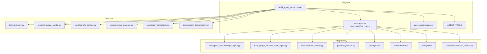
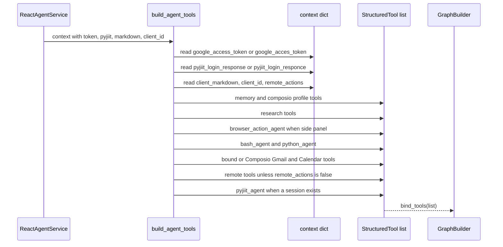
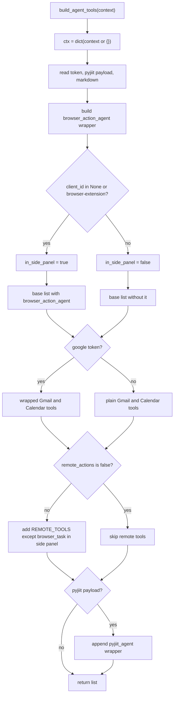
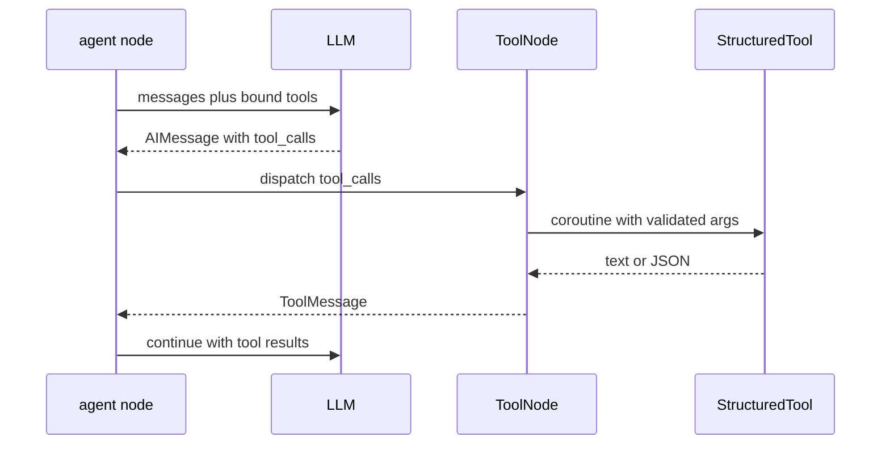
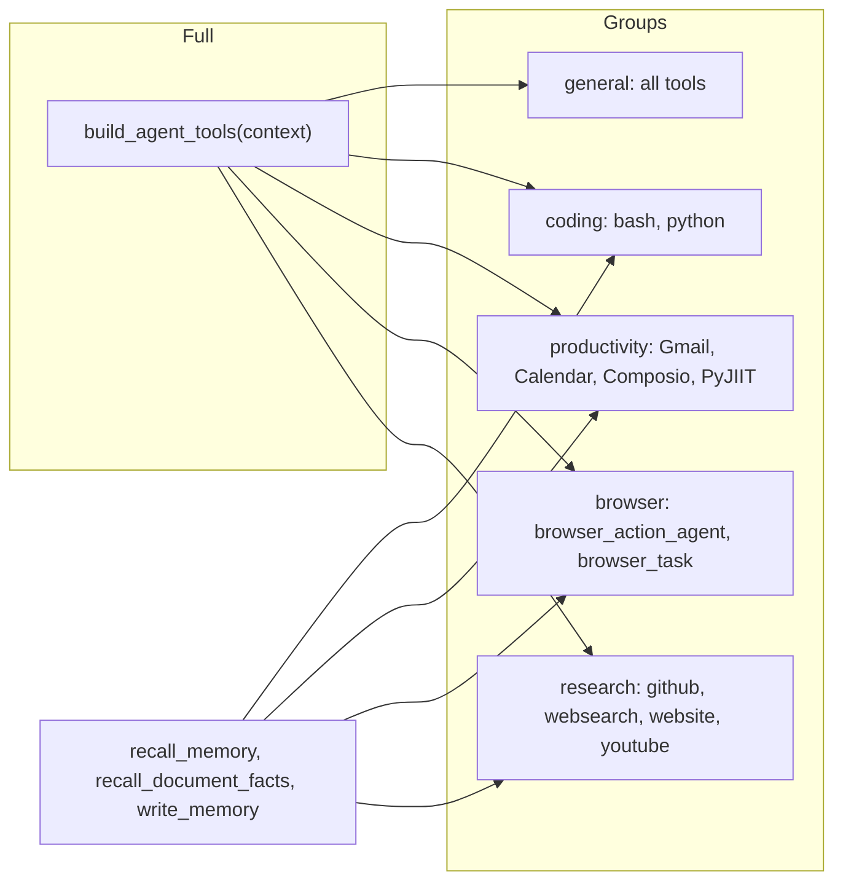

# Tool architecture and design

`agents/react_tools.py` is the catalogue the built-in agents read from. It defines four research tools, six Google Workspace tools, a PyJIIT attendance tool, three memory tools, two Composio profile tools, a browser tool, and three remote tools, then imports bash and Python tools. `build_agent_tools(context)` assembles the list for one request, injecting credentials and client-specific variants.

The registry does not implement the integrations. Its job is to present them to the model with names, descriptions, and argument schemas that match the downstream services. Everything behind a tool lives in `tools/` or `services/`.

Key capabilities:
- Context-aware assembly from one request dictionary.
- Static, imported, and request-built layers in one ordered list.
- Typed inputs with explicit bounds on counts and confidence values.
- Composio fallback inside the Gmail and Calendar tools when no direct token is present.
- One list shared by the ReAct agent and the supervisor partitions.
- Memory tools that coerce model-supplied labels into internal enums.

## Repository layout

The registry imports tool modules and service entry points at module load. Some tools are created once at import; others are rebuilt per request because they close over a token or a session payload.

## Building blocks

The registry has three layers.

- Module-level tools created at import: `github_agent`, `websearch_agent`, `website_agent`, `youtube_agent`, `gmail_agent`, `gmail_send_email`, `gmail_list_unread`, `gmail_mark_read`, `calendar_agent`, `calendar_create_event`, and `pyjiit_agent`.
- Imported tool collections: `MEMORY_TOOLS` from `tools/memory.py`, `COMPOSIO_PROFILE_TOOLS` from `tools/composio_profile.py`, `REMOTE_TOOLS` from `tools/remote_actions.py`, plus `bash_agent` and `python_agent`.
- Request-built tools: `dynamic_browser_action_agent`, and credential-bound wrappers for Gmail, Calendar, and PyJIIT.

`AGENT_TOOLS = build_agent_tools()` at module scope is the no-context list. `GraphBuilder` uses it when neither an explicit tool list nor a context is supplied.

## How the registry assembles a request

The sequence is deterministic. Read the context, build the browser wrapper, choose the base list, decide on Google, decide on remote, then decide on PyJIIT.

The context keys tolerate two historical spellings. `google_access_token` and `google_acces_token` are both read, as are `pyjiit_login_response` and `pyjiit_login_responce`. This is compatibility with existing callers, not a typo in the current code.

## Tool inventory

| Name | Input model | What it calls |
| --- | --- | --- |
| `github_agent` | `GitHubToolInput` | `run_github_repo_agent(url, question, chat_history)` |
| `websearch_agent` | `WebSearchToolInput` | `web_search_pipeline`, up to 10 results |
| `website_agent` | `WebsiteToolInput` | `markdown_fetcher` then a website chain |
| `youtube_agent` | `YouTubeToolInput` | a YouTube transcript chain |
| `gmail_agent` | `GmailToolInput` | Composio Gmail search, or `get_latest_emails` |
| `gmail_send_email` | `GmailSendEmailInput` | Composio send, or `send_email` |
| `gmail_list_unread` | `GmailListUnreadInput` | Composio unread query, or `list_unread` |
| `gmail_mark_read` | `GmailMarkReadInput` | Composio modify, or `mark_read` |
| `calendar_agent` | `CalendarToolInput` | Composio event list, or `get_calendar_events` |
| `calendar_create_event` | `CalendarCreateEventInput` | Composio create, or `create_calendar_event` |
| `pyjiit_agent` | `PyjiitAttendanceInput` | `Webportal` attendance fetch |
| `browser_action_agent` | `BrowserActionInput` | `BrowserRuntimeService.start_session` |
| `recall_memory` | `RecallMemoryInput` | `MemoryService.search` |
| `write_memory` | `WriteMemoryInput` | `MemoryService.store_claim` |
| `recall_document_facts` | `RecallDocumentFactsInput` | `MemoryService.search_document_facts` |
| `composio_linkedin_me` | `ComposioLinkedInMeInput` | `ingest_composio_linkedin_self` |
| `composio_aeroleads_linkedin` | `ComposioAeroLeadsLinkedInInput` | `ingest_composio_aeroleads_linkedin` |
| `browser_task` | `BrowserTaskInput` | bridge `task.run` |
| `composio_apps` | `ComposioAppsInput` | connected accounts and toolkit actions |
| `composio_action` | `ComposioActionInput` | `execute_toolkit_action` |

`bash_agent` and `python_agent` come from `tools/bash_tools/bash.py` and `tools/python_tools/python.py` and are appended without a wrapper. Their schemas live in those modules.

## Execution through the graph

`GraphBuilder` compiles a StateGraph with an agent node and a `ToolNode`. `_create_agent_node` binds the list to the chat model with `bind_tools`. The model replies with `AIMessage.tool_calls`, the tool node runs each coroutine with validated arguments, and each result returns as a `ToolMessage`.

A tool call can be replayed through the loop guard. `tool_loop_verdict(messages)` maps call ids to names and records one step per `ToolMessage`, which is how repeated identical tool results become a warning and then a stop. The guard is rebuilt from history on every model turn, so the graph state stays small.

## Supervisor partitions

`agents/while_loop_harness.py` calls `build_agent_tools(self.context or None)` and `_partition_tools(tools)`. The groups are `research`, `browser`, `productivity`, and `coding`, plus a `general` group with the full list. Memory tools are prepended to every group. A tool that appears in several groups is the same `StructuredTool` object, not a copy.

The partition list is by tool name. A renamed tool silently drops out of its group, which is why names should stay stable after release. `browser` includes both browser tools and relies on the registry to have removed the one the client cannot run.

## Dependencies

`langchain-core` supplies `StructuredTool`, and `pydantic[email]>=2.9.0` supplies the schemas, including `EmailStr` and `HttpUrl`. The registry imports service modules at module load, so a broken optional integration import can fail the whole tool list. Tool modules in turn import their provider clients, which is why a conditional integration should defer heavy imports into the coroutine.

## Performance

Tool count varies by context. The base list is three memory tools, two Composio profile tools, four research tools, bash, and Python, plus the browser tool in a side panel. A Google token adds six wrapped tools. Remote tools add three. PyJIIT adds one. The supervisor partitions this list by name and prepends memory tools to each group, so the same object can appear in several groups.

Result sizes are capped in the tools themselves: 10 web results with 320 character summaries, 40 Composio actions, 12000 characters for a Composio action result, and 900 seconds for a remote browser task. The registry adds no caching layer; a repeated call repeats the work.

## Troubleshooting

- Gmail falls back to Composio: no request-level Google token was supplied. With no active account, the tool returns `Failed to fetch Gmail messages via Composio: ...`.
- `Composio API key is not configured`: `COMPOSIO_API_KEY` is missing. `execute_toolkit_action` raises `ComposioNotConfigured`, and the Gmail wrapper turns it into tool text.
- Wrong tools in a client: check `client_id`. Any value other than `None` or `browser-extension` removes `browser_action_agent`, and `remote_actions=False` removes all three remote tools.
- `pyjiit_agent` is absent: no `pyjiit_login_response` or `pyjiit_login_responce` was passed in context.
- A memory is stored in the wrong segment: the model supplied a label outside `_SEGMENT_ALIASES`, so it defaulted to `CONTEXTUAL`. Send one of the documented names.
- Duplicate memories: `write_memory` relies on the memory service reconciliation path. Repeated facts may be merged or superseded rather than stored twice.
- A tool schema rejects a URL: `HttpUrl` requires a scheme. Pass `https://...`, not a bare hostname.
- Importing the registry fails: an optional integration import broke at module load. Move heavy imports inside the coroutine when the tool is conditional.

## Appendix

### Implementation examples

- `build_agent_tools(context=None)`: returns the ordered tool list for one request.
- `AGENT_TOOLS`: the no-context list used by `GraphBuilder`.
- `_write_memory(...)`: coerces labels, stores a claim, returns JSON.
- `_partition_tools(tools)`: builds the supervisor groups by name.

### Source files

- `agents/react_tools.py`
- `agents/react_agent.py`
- `agents/while_loop_harness.py`
- `tools/memory.py`
- `tools/remote_actions.py`
- `tools/composio_profile.py`
