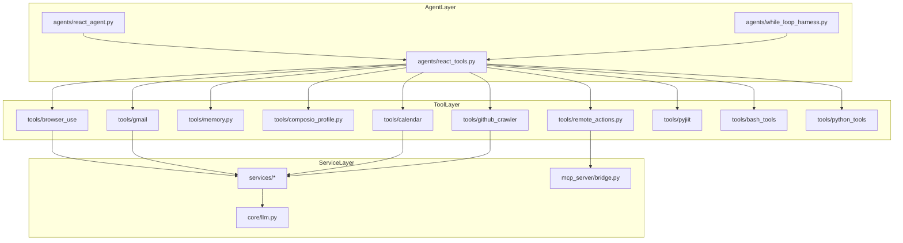
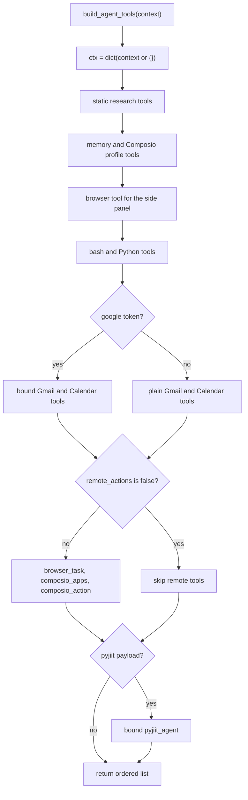
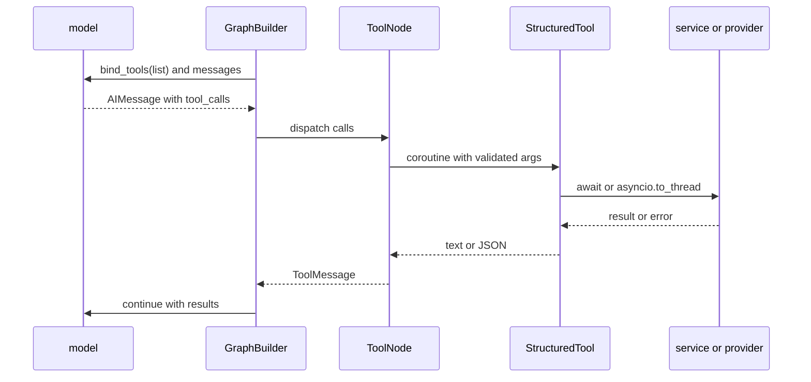
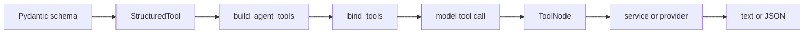
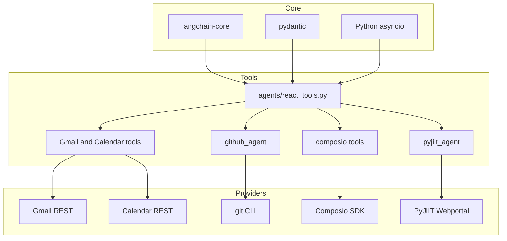

# Tool system

The tool system is how the built-in agents reach the outside world. Every tool is a LangChain `StructuredTool` with a Pydantic input model and an async coroutine. `agents/react_tools.py` defines the catalogue, `build_agent_tools(context)` assembles a list for one request, and `GraphBuilder` binds that list to the chat model.

The layer is deliberately thin. A tool validates its arguments, calls a service or provider, and returns text or JSON. Domain logic lives in `tools/` and `services/`, prompts live in `prompts/`, and API routes sit beside the tools for direct calls.

Key capabilities:
- One interface for every capability: name, description, coroutine, `args_schema`.
- Context-aware registration for Google tokens, PyJIIT sessions, client type, and remote permission.
- Credential injection so the model never passes secrets by hand.
- Blocking work offloaded with `asyncio.to_thread`.
- Stable names shared by the ReAct agent, the supervisor partitions, and prompts.
- Plain-text errors that let a turn continue instead of failing.

## Pages in this folder

| Page | What it covers |
| --- | --- |
| [Tool Architecture and Design](Tool%20Architecture%20and%20Design) | The registry layers, assembly order, full inventory, graph execution. |
| [Browser Automation Tools](Browser%20Automation%20Tools) | `browser_action_agent` and `browser_task`, and when each is registered. |
| [Content Processing and Extraction Tools](Content%20Processing%20and%20Extraction%20Tools) | Website and YouTube Q&A, markdown fetch, transcripts, attachments. |
| [External Service Integration Tools](External%20Service%20Integration%20Tools) | Gmail, Calendar, GitHub, PyJIIT, and Composio tools. |
| [Custom Tool Development Guide](Custom%20Tool%20Development%20Guide) | How to add a schema, coroutine, and registration safely. |

## Repository layout

Tool implementations live under `tools/<domain>/`. The registry imports them and adds wrappers. Services hold shared logic, and the routes expose some of the same operations over HTTP.

## How tools are assembled

The registry has three layers. Module-level tools are created once at import. Imported collections such as `MEMORY_TOOLS`, `COMPOSIO_PROFILE_TOOLS`, and `REMOTE_TOOLS` are appended as lists. Request-built wrappers close over a Google token, a PyJIIT payload, or client markdown.

`AGENT_TOOLS = build_agent_tools()` is the no-context list. The supervisor calls `build_agent_tools(self.context or None)` and then partitions the result into research, browser, productivity, and coding groups. Memory tools are prepended to every group.

## How a call runs

A tool call may repeat. `tool_loop_verdict(messages)` replays the message list through `LoopGuard`, so identical tool results produce a warning and then a stop instead of an endless loop. The guard is rebuilt every model turn.

## Design rules

- The schema is the contract. Put bounds in `Field(ge=..., le=...)` and descriptions on every field.
- The tool description names the action and the object, not the implementation file.
- Credentials belong in context, not in a tool argument the model has to invent.
- A provider failure returns a sentence. Raising ends the turn and hides the cause from the model.
- A conditional integration must also be absent from the tool list when it is unavailable.
- Keep names stable. Supervisor groups and prompts refer to tool names directly.
- Cap output close to the source. Search summaries, action results, and trails all have limits.

## Dependencies

`langchain-core` supplies `StructuredTool`. `pydantic[email]>=2.9.0` supplies `BaseModel`, `Field`, `EmailStr`, and `HttpUrl`. Provider packages are imported by the tool modules that need them: `requests` for Gmail and Calendar, the Composio SDK for toolkit actions, `git` and `gitingest` for repositories, and the local PyJIIT client for the campus portal.

## Performance

Tool count varies from 11 core tools to roughly 22 when the browser, Google, remote, and PyJIIT tools are all included. Blocking calls use `asyncio.to_thread`, so a slow provider does not stall the event loop. Retry behaviour is not in the registry; each tool owns its own timeouts, and the bridge adds its own. Result caps are the main defense against context overflow.

## Troubleshooting

- A tool is missing from the model: check `client_id`, `remote_actions`, and whether the required token or session payload reached `build_agent_tools`.
- The model calls the wrong tool: read the tool descriptions. Similar names with vague descriptions cause misroutes.
- A tool uses the wrong credential path: context injection did not run, so the plain module-level tool was used. Check the context keys in `build_agent_tools`.
- `ImportError` when loading the agent: a module-level import of an optional integration failed. Move it inside the coroutine.
- A tool result is truncated: check the cap in the tool, not the prompt. Search, Composio, and remote trails all have explicit limits.
- A repeated call never stops: the tool is not reaching `tool_loop_verdict`, or it returns a different result every time.

## Appendix

### Implementation examples

- `build_agent_tools(context=None)`: ordered list for one request.
- `AGENT_TOOLS`: the no-context baseline.
- `_ensure_text(value)`: normalise a chain response to text.
- `_format_chat_history(history)`: flatten history for prompts.
- `_partition_tools(tools)`: supervisor groups by name.

### Source files

- `agents/react_tools.py`
- `agents/react_agent.py`
- `agents/while_loop_harness.py`
- `tools/browser_use/tool.py`
- `tools/remote_actions.py`
- `tools/memory.py`
