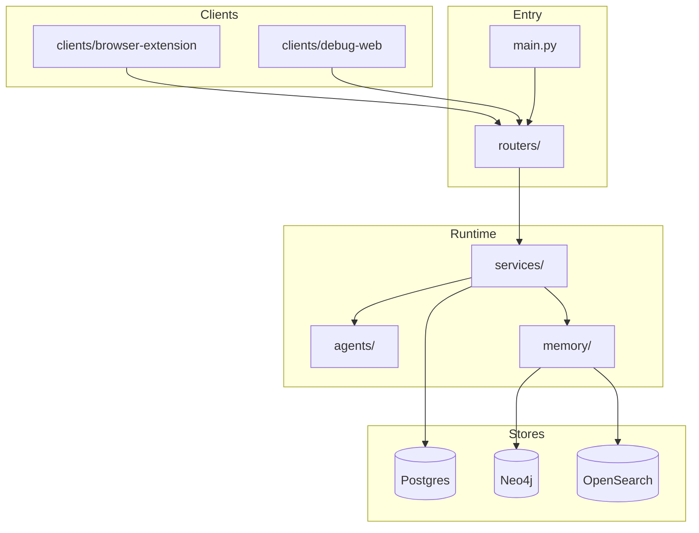
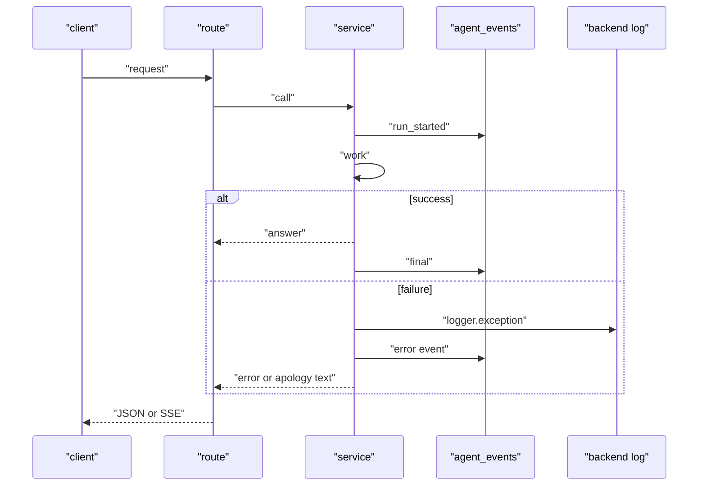
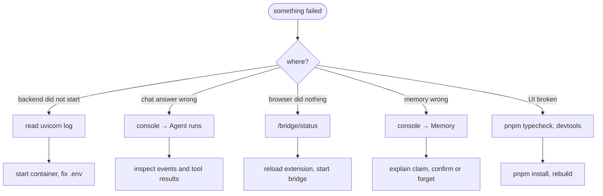
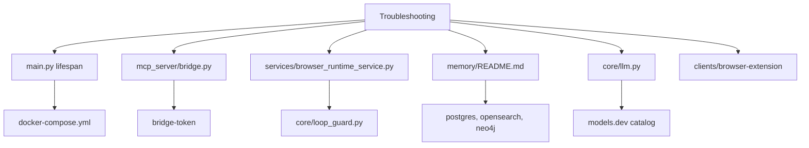

# Troubleshooting and FAQ

This page collects failure modes that have a traceable cause in the code: startup guards that skip a store, provider errors, bridge states, loop guard stops, memory reconciliation outcomes, and build problems. Each entry names the symptom, the mechanism behind it, and the check or fix.

If a symptom is not here, start with the run trace in the console. Every chat turn, browser runtime session and supervisor round records events, tool calls and subagent rows, so the failure usually has a row before it has a message.

Key capabilities:
- Startup and database problems
- Model and provider selection problems
- Extension, bridge and MCP problems
- Browser action and loop guard problems
- Memory ingestion and retrieval problems
- Build and type checking problems
- Answers to recurring design questions

## Repository layout

## Building blocks

- `main.py`: startup guards. A warning here is the first clue for a missing store or bot token.
- `core/config.py`: every environment variable and its default.
- `core/llm.py`: provider construction and key resolution.
- `core/loop_guard.py`: the stop condition for repeated browser or tool steps.
- `mcp_server/bridge.py`: host or relay election and the browser WebSocket.
- `services/browser_runtime_service.py`: blocker detection and action validation.
- `services/react_agent_service.py`: the chat path, including error recovery.
- `memory/README.md`: the write and read model, with the caveats that matter.

## How it fits together

A failure has a path. The client posts, the route validates, the service writes a run, the agent calls tools, and the error lands in the run events before the answer is saved. That is why the console is the first stop for anything that is not a startup failure.

## Where to look first

## Startup and databases

**Backend starts but says `Postgres init skipped`.** `main.lifespan` wraps `init_db()` in a `try` and logs a warning instead of exiting. Causes: Docker down, password mismatch, port 5433 taken. Check `docker compose ps` and `docker compose logs postgres`.

**`Neo4j init skipped`.** The graph is optional at boot. Memory retrieval still works from Postgres and OpenSearch, but graph expansion is empty. Start the container and restart the API.

**`OpenSearch init skipped`.** Search falls back to keyword-only behaviour and context gets thinner. OpenSearch needs about 1 GB free to Docker. Check `curl http://localhost:9201/_cluster/health`.

**A migration fails halfway.** Each `upgrade(conn)` runs inside one transaction. A failure rolls back and is not recorded, so the next boot retries it. Fix the SQL and restart.

## Models and providers

**`API key for 'google' not found`.** `LargeLanguageModel` checks the passed key, then the env variable. The database secret is resolved earlier by `resolve_provider_secrets`. Add a key in Settings → Model.

**`Unsupported LLM provider`.** Accepted values are `google`, `openai`, `anthropic`, `ollama`, `deepseek`, `opencode`, `opencode-go`, `openrouter`. A subscription runtime id is handled before the LLM path.

**A model in the picker is rejected.** The catalog comes from models.dev and may be newer than your key's entitlements. Pick another model or point the provider at a gateway.

**Temperature errors on a reasoning model.** `llm_for` asks `model_info` whether the model accepts temperature and passes `None` when it does not.

**The picked model is ignored.** The override reads `X-Agentic-Provider` and `X-Agentic-Model`. A client that does not send them gets the saved default.

## Extension and bridge

**The side panel says the backend is offline.** The panel calls `http://localhost:5454` unless `baseUrl` is set or `VITE_API_URL` at build time. Check both.

**`No browser is connected to the Agentic Browser bridge`.** The bridge is up but no extension WebSocket is attached. Open the browser with the extension and check its MCP Bridge section.

**Bridge closes with 4403.** The origin was not an extension scheme, or `AGENTIC_BROWSER_EXTENSION_IDS` excludes this build.

**Bridge closes with 4400.** The first frame was not `hello` within 10 seconds. Rebuild the extension.

**`/bridge/call` 401 or 403.** 401 is a missing or wrong token. 403 means a browser sent the request; only local processes may relay.

**MCP tools changed but the client shows the old list.** Settings apply through a 2 second file watcher and `tools/list_changed`. Clients that ignore it need a restart.

## Browser actions

**The agent plans an action but nothing happens.** The backend only returns the action; the extension executes it. Check the work log for `browser_action_agent` and the continuation call.

**`Chrome does not let extensions script chrome://...`.** The handler blocks browser-internal pages and the web store. Navigate to a normal site.

**Actions are ignored by the page.** Clicks and typing go through `chrome.debugger` when available. With DevTools open, the debugger cannot attach and the fallback uses synthetic events. Close DevTools.

**A login, captcha or permission prompt stops the run.** `_detect_user_blocker` returns `status="blocked"`. This is intended.

**A ref like `e12` stopped working.** Refs live in the page's isolated world and drop on navigation. Take a new snapshot.

**The run stops with "going in circles".** The loop guard warned and then stopped after the grace period. Change the instruction or starting page.

## Memory

**A fact the user said is missing.** Check: the turn was trivial, extraction failed twice, the gate rejected it, or reconciliation called it duplicate.

**A changed fact did not replace the old one.** The reconciler was not confident. Mention it again in a later turn.

**Two contradictory facts both exist.** That is the designed outcome when the reconciler is unsure. Both are linked with `CONTRADICTS`. Confirm one or forget the other.

**Search returns nothing for a reasonable question.** Weak matches are dropped. If the embedding provider changed, old vectors are not comparable. Re-ingest or clear memory.

**Local mode has poor recall.** Without a Google or OpenAI key, memory uses a word-hashing embedder. That is a known roadmap gap.

**A forgotten fact still appears in a document answer.** Forget redacts chat artifacts but does not delete imported documents. Forget the document source too.

**`memory_recall` over MCP fails.** The memory MCP tools call the backend at `AGENTIC_BROWSER_API_URL`. Start it.

## Attachments and voice

**`Attachments must be uploaded through /api/upload first`.** `services/attachments.py` refuses paths outside `uploads/`.

**An image is rejected by the model.** The agent checks whether the picked model sees images and returns a refusal instead of guessing.

**Voice errors about `metadata_errors`.** `services/voice_input.py` patches `av.open` for PyAV 15 and faster-whisper 1.2.1. Check the installed `av` version.

**Cloud transcription fails and the text is empty.** Both routes fall back to local Whisper. If local Whisper is unavailable, there is no fallback left.

## Build and type checking

**`pnpm build:extension` cannot find `.wxt` types.** Run `pnpm install`; `postinstall` runs `wxt prepare`.

**Type errors after pulling.** Run `pnpm typecheck:extension` and the shared package's `tsc --noEmit`.

**Console builds but deep links 404 on refresh.** The host must rewrite unknown paths to `index.html`.

**`pnpm screenshots` cannot launch Chromium.** Run `pnpm exec playwright install chromium`.

## FAQ

**Does the backend have authentication?** No. It is a single-user local service. CORS limits browser origins and the bridge has a token, but any local process can call the API.

**Can two backends share the databases?** Not safely for memory writes. The reconcile lock is in-process.

**Does the agent act without asking?** It stops at logins, captchas and permission prompts, and is told to ask before purchases, messages, deletions and credentials. There is no per-action approval UI yet.

**Where do API keys live?** In `.env` or encrypted `app_settings` rows. OAuth tokens live encrypted in `browser_credentials`.

**Why does the extension need `debugger` permission?** For trusted input events and screenshots through CDP.

**Can I use it on Firefox?** Yes, with the MV2 build. The debugger path is Chrome-only, so input uses DOM events.

**What runs on a subscription?** Claude through the Claude Agent SDK, ChatGPT through `codex exec`, Google AI through Antigravity ACP, and OpenCode through `opencode acp`.

**How long are chats kept?** Until deleted. Compaction summarizes older messages but does not delete originals.

**How do I wipe everything?** `POST /api/memory/clear` clears the three memory stores. Conversations and runs are separate tables.

## Dependencies

## Performance

- Startup catches every optional dependency, so a degraded stack is normal.
- The bridge waits 3 seconds for a browser and calls time out at `timeout + 2`.
- The loop guard warns before it stops.
- The browser runtime keeps the last 6 observations and up to 40 notes.
- Compaction triggers at half the model window and keeps the last 8 messages verbatim.

## Appendix

### Implementation examples
- Health: `curl http://127.0.0.1:5454/api/genai/health/`.
- Bridge: `curl http://127.0.0.1:5455/bridge/status`.
- Runs: `GET /api/debug/runs?status=failed&limit=20`.
- One run: `GET /api/debug/runs/{run_id}` and `/events`.
- Memory explain: `GET /api/memory/explain/{claim_id}`.
- Clear memory: `POST /api/memory/clear`.

### Source files
- `README.md`
- `main.py`
- `core/config.py`
- `core/llm.py`
- `core/loop_guard.py`
- `mcp_server/bridge.py`
- `mcp_server/server.py`
- `services/react_agent_service.py`
- `services/browser_runtime_service.py`
- `services/attachments.py`
- `services/voice_input.py`
- `memory/README.md`
